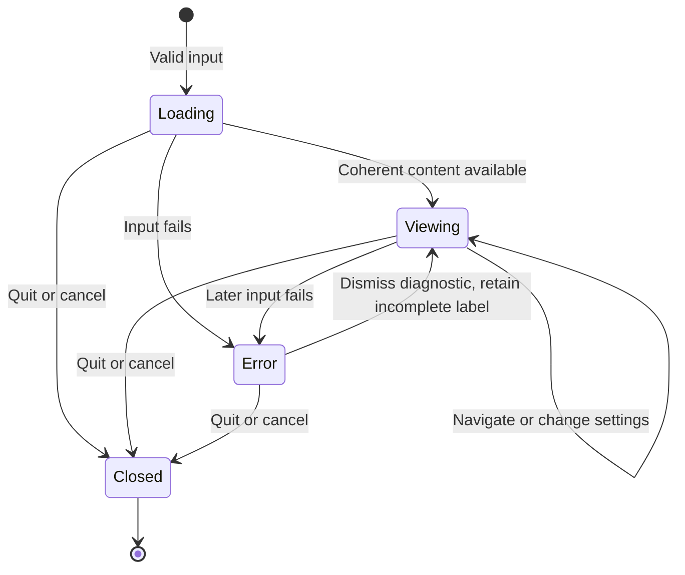

# Native diff viewer: product spec v0.1

Status: proposed behavior, not a description of an existing implementation.
Implementation progress is recorded separately in [IMPLEMENTATION_STATUS.md](../history/IMPLEMENTATION_STATUS.md).
The [large-diff implementation specification](LARGE_DIFFS.md) now owns the next batch, exact scale corpus, and proposed performance targets.
Date: 2026-09-10.
Scope: a read-only Rust terminal viewer. The name and proposed defaults remain open to user review.

## 1. The promise

The viewer makes code changes as readable as Pierre, within the limits of a terminal character grid.
Every displayed change corresponds to the input. Large inputs do not prevent navigation or cancellation.

Priority order: truthful content, visual quality, responsive interaction, then additional features.
A faster result with missing content or misleading highlights is a failure.

### Terms

- **Changeset:** the ordered collection of file changes in one input.
- **Hunk:** a group of changes and nearby unchanged lines.
- **Source line:** a line from the old or new file, with a one-based line number.
- **Display row:** one terminal row. A wrapped source line occupies several display rows.
- **Gutter:** the narrow area for line numbers and addition/deletion signs.
- **Anchor:** a file, side, and source line that identifies the current reading position.
- **Visible area:** the terminal cells available for the diff, excluding the fixed top and bottom rows.
- **Partial patch:** a patch that lacks some unchanged source content.
- **Styled:** the visible content has its intended syntax colors and inline-change emphasis, or an explicit fallback label.

## 2. The simple case

The user opens a patch. The viewer occupies the current terminal window and displays the first file at the top.
Wide windows use side-by-side layout. Narrow windows use unified layout. The user can choose either layout explicitly.

The user reads downward through one continuous stream of file changes. File and hunk shortcuts move within that same stream.
The user presses `q`. The viewer restores the terminal and returns to the shell without printing the changeset into shell history.

## 3. What appears on screen

### The frame

- The top row contains the input label, file count, effective layout, and active theme.
- The middle contains the continuous diff stream. No sidebar appears by default.
- Each file starts with one header: path, change type, and added/deleted line counts.
- A renamed file header displays both paths. A mode-only change displays both modes.
- The current file header stays at the top of the visible area after its original header scrolls away.
- The bottom row contains the current file/hunk, loading or error state, and short key hints.
- Logs, shell commands, timestamps, and internal progress messages never occupy code rows.
- File counts remain labeled incomplete until the viewer reaches the end of the input.

The fixed frame uses one row at the top and one at the bottom. The sticky file header consumes one additional visible row.
When that header reaches its original position, it appears once, not twice.
Hunk separators contain the original `@@` ranges and available function text. Long labels clip, with an ellipsis.
When the selected path exceeds the file-picker width, its label wraps to display the complete path.

### Side-by-side layout

The old file occupies the left pane. The new file occupies the right pane. Both panes share one vertical position.
Each pane has its own line number, sign, and code area. A one-cell neutral divider separates the panes.
The left pane receives half the remaining width, rounded down. The right pane receives the remainder.

Structural example, not a color mockup:

```text
src/retry.rs                                      Modified  +2 -1
@@ -1,3 +1,4 @@
 1   fn run() {               │ 1   fn run() {
 2 -     let retries = 3;     │ 2 +     let retries = 5;
                             │ 3 +     retry(retries);
 3   }                        │ 4   }
```

Related replacement lines align where a bounded similarity rule finds a clear match.
Unpaired additions or deletions have an empty cell area on the opposite side. That area has no fabricated line number or sign.
The empty area uses a quiet neutral background, distinct from unchanged code.
Alignment never changes the order or text of either source file.

### Unified layout

Unified layout uses one code area, two line-number columns, and one sign column.
An unchanged line has both line numbers. A deletion has only its old number. An addition has only its new number.
Within each replacement block, deletions precede additions.

```text
src/retry.rs                                      Modified  +2 -1
@@ -1,3 +1,4 @@
 1  1   fn run() {
 2    -     let retries = 3;
    2 +     let retries = 5;
    3 +     retry(retries);
 3  4   }
```

Both layouts use the same source identities and inline-change spans. A layout switch does not recompute the meaning of the changeset.

### Spacing and line treatment

- Each line-number column has at least three cells. It grows to fit that file's largest known line number.
- Each sign occupies one cell, followed by one space before the code.
- Line-number widths remain fixed after the file is complete. They do not change while the user scrolls.
- Addition and deletion backgrounds extend to the edge of their code pane, including unused cells.
- Syntax colors remain visible over change backgrounds. Whole changed lines do not become solid red or green text.
- Inline emphasis covers changed spans, not the entire replacement line.
- Inline comparison separates punctuation from words and preserves complete graphemes. Unchanged separators do not receive emphasis.
- Identifiers retain word-level emphasis. The [inline policy](../history/INLINE_HIGHLIGHTING.md) defines boundaries and covered checks.
- A small gutter marker identifies the active source line without covering its inline highlights.
- No blinking decoration, scrolling animation, or automatic movement accompanies background highlighting.

### Color and theme contract

The initial themes are Pierre Dark and Pierre Light, derived from the pinned reference.
The default is dark. The viewer does not depend on an automatic terminal-theme query.

| Role | Dark reference | Light reference |
| --- | --- | --- |
| Code background | `#0a0a0a` | `#ffffff` |
| Code foreground | `#fafafa` | `#0a0a0a` |
| Addition accent | `#07c480` | `#18a46c` |
| Deletion accent | `#ff2e3f` | `#d52c36` |
| Modified accent | `#009fff` | `#009fff` |

Accent colors are not the full-row backgrounds. The implementation derives background and emphasis colors from Pierre's theme and CSS composition rules.
Before visual acceptance, the project records every final RGB value and its reference role in one theme file.
Browser alpha layers become opaque terminal colors against the selected background. Terminal transparency is not part of the reference appearance.

The visual pass includes context, gutter, separator, empty split cells, change rows, changed words, selection, and search matches.
The exact palette includes those roles before milestone 1 can pass. This draft does not invent final composed values without a visual comparison.

The initial syntax-language set is C, Rust, TypeScript/TSX, Python, and JSON.
Unknown languages display plain source text with full change backgrounds and available inline emphasis.
Exact Shiki token parity across all languages is outside v0.1. Differences in the initial language set require explicit visual review.
For patch-only input, unknown preceding syntax state remains unknown. The status row displays `Syntax context incomplete` for affected files.
The viewer does not infer a complete multiline string or comment state from absent source lines.

Truecolor is the visual acceptance profile. A 256-color or no-color profile retains signs, line numbers, and content.
Reduced-color profiles receive correctness checks, not claims of identical visual fidelity.

## 4. Settings and controls

These are proposed defaults for our viewer, not claims about Pierre defaults.

| Setting | Default | Behavior |
| --- | --- | --- |
| Layout | `auto` | Split at 120 columns or wider, unified below 120 |
| Explicit layout | Unset | `split` or `unified` overrides the automatic choice |
| Theme | `dark` | `dark` or `light`, with the same content and position |
| Wrapping | Off | Horizontal scrolling preserves unwrapped source lines |
| Line numbers | On | Hiding numbers does not hide signs or alter source identities |
| Inline changes | `word` | `word`, `char`, or `off` |
| Tab width | 4 | Positive integer from 1 through 16, measured from the start of code |
| Context for generated diffs | 3 lines | Applies to two-file and Git inputs, not the contents of supplied patches |
| Clipboard access | Off | Explicit `osc52` setting enables clipboard writes where the terminal supports them |

The command-line settings override defaults. Interactive changes last for the current process only.
No settings file, repository-local executable settings, or automatic persistence exists in v0.1.
The settings panel exposes layout, theme, wrapping, line numbers, inline changes, and tab width.
Clipboard access remains a launch-time choice. Context count remains a launch-time choice for generated diffs.

### Reading controls

| Input | Result |
| --- | --- |
| `j` / Down, `k` / Up | Move the active row by one display row and keep it visible |
| Page Down / Page Up | Move by the visible code height minus one row, with a minimum of one |
| Mouse wheel | Scroll three display rows per received wheel event, without additional acceleration |
| `g` / `G` | Go to the first / last available source row |
| `]` / `[` | Go to the first changed source line in the next / previous hunk |
| `n` / `N` | Go to the next / previous file header, relative to the current file |
| Left / Right | Scroll code horizontally by four cells when wrapping is off |
| Tab | Change the active side in split layout, retaining the display row |
| `u` | Toggle the effective split/unified layout and leave automatic layout mode |
| `w` | Toggle wrapping |
| `t` | Toggle dark/light theme |
| `s` | Open settings |
| `f` | Open a file picker, with literal substring filtering by path |
| `/` | Open literal, case-sensitive search over available source text |
| Enter on a context gap | Reveal up to 20 additional lines from the start of that gap |
| `v` | Start or finish a line selection on the active side |
| `y` | Copy the selected source lines, or the active source line, with explicit clipboard access |
| `?` | Open help with the full key list and current settings |
| Escape | Close an overlay, otherwise clear selection, otherwise no effect |
| `q` / Ctrl-C | Quit / cancel, with the exit behavior in section 7 |

File jumps include metadata-only files. At either boundary, the command leaves the reading position unchanged without wrapping.
During loading, commands use completed files only. Later file arrivals do not repeat earlier commands.
These controls use pager conventions, not Vim compatibility. `n` / `N` follows Delta's file navigation convention, not Vim's search convention.
The 2026-09-11 navigation decision replaces the prototype `{` / `}` file bindings and removes numeric prefixes from scope.
Search remains a later feature. Its controls must not silently replace file navigation.

When a search field or file filter has focus, letter keys type text. `q` quits only outside those text fields.
Enter accepts the selected item or setting. Escape cancels an unsubmitted field without changing the reading position.
The next/previous file and hunk commands do not wrap at the ends. The status row reports the boundary.
When search crosses an end, it wraps and displays `Search wrapped`.

Mouse clicks select a source row and its side. Wheel movement retains the active row while that row remains visible.
When scrolling hides the active row, the nearest visible source row becomes active.
Clicks on a file-picker entry open that file. Clicks on a context gap have the same effect as Enter.
Custom mouse-drag text selection is outside v0.1. Keyboard line selection remains available.

### Position, selection, and wrapping

A layout switch retains the active source line, text position, side, and approximate screen row.
Shared context retains the active side. A deletion uses the old source, and an addition uses the new source.
The same rules apply to width changes, wrapping, and line-number visibility.
Mouse selection anchors the clicked text position. Keyboard movement anchors the start of its new displayed segment.
An anchor persists through repeated layout changes, including a temporary size below the usable minimum. Reading movement establishes a new anchor.
When a split counterpart is absent, Tab moves side focus without treating the empty area as a source line.
Copy and selection remain unavailable on headers, separators, and empty split cells.

Wrapping splits code at display-cell boundaries without splitting a grapheme cluster.
Continuation rows have no repeated source number or change sign. A small continuation marker distinguishes them from empty split cells.
In split layout, paired source lines occupy the larger of their wrapped heights. Shorter sides receive empty continuation space.
Horizontal scrolling moves both code panes together. Gutters and headers do not move horizontally.
With wrapping on, horizontal keys have no effect.
With the anchored text visible, disabling wrapping retains the horizontal offset. Otherwise, it adjusts the offset to reveal that text.

A line selection includes only one file and one side. It cannot cross a missing context range.
At a missing range or file boundary, selection extension stops and the status row explains the boundary.
Selection uses source-line identities, so wrapping never inserts newlines into copied text.
Layout changes preserve the selection. A file jump clears it.
Clipboard output contains original tabs and line endings, without numbers, signs, or terminal escapes.
With clipboard access off, `y` displays `Clipboard disabled: start with --clipboard=osc52`.
An OSC 52 write reports `Copy request sent`, not a claim that the host clipboard changed successfully.

## 5. Inputs and content correctness

The [exact-source/context specification](EXACT_SOURCE_CONTEXT_SPEC.md) refines the proposed Git/two-file inputs, complete-context coloring, and expansion behavior.
The [input scenario analysis](INPUT_SCENARIO_ANALYSIS.md) extends the plan to GitHub PRs and records the boundaries for other source modes.
It is not an implementation-status claim. `CURRENT_STATE.md` identifies the current executable and completed work.

The proposed commands are not installed commands yet:

```text
diffs patch change.patch
git diff --no-ext-diff --no-textconv --no-color | diffs patch -
diffs files OLD NEW
diffs git --repo PATH --base REV --head REV
```

The initial Git command compares two explicit commit revisions. It does not change the index or working tree.
Git comparison disables external diff helpers, text conversion, and user-defined pagers.
The output retains explicit input order. The viewer does not reorder files for appearance or speed.

Supported patch content includes ordinary Git/unified text patches, file additions/deletions, renames, mode changes, and binary-change notices.
Combined merge diffs are unsupported in v0.1. They produce an explicit diagnostic instead of an ordinary two-sided display.
Binary files display a metadata card, not invented textual hunks. Rename-only and mode-only changes also remain visible.
Equal two-file inputs display `No changes`. An empty patch displays `No changes` after successful end-of-input parsing.
Non-patch prose produces an input error rather than a misleading empty result.

### The non-negotiable rules

- Every available source line retains its bytes, order, side, and source line number.
- Reconstructing either side from the parsed model agrees with the supplied source content wherever that content exists.
- Addition/deletion totals count source lines, not wrapped rows, alignment gaps, headers, or continuation markers.
- Inline highlights preserve every visible character. Their spans match the selected comparison rule, including the documented word-mode gap joining.
- Word mode can join tiny gaps for readable emphasis, as Pierre does. This does not change source text or line classification.
- Unsupported styling never removes content. The status row identifies a styling fallback.
- Missing final newlines have an explicit marker attached to the affected side.
- CRLF input retains its original line endings for copying. Display excludes the line-ending bytes.
- Tabs affect display width only. Whitespace changes remain real changes.
- Embedded escape sequences and other terminal-control bytes display as safe, labeled representations. They never execute as terminal commands.
- Invalid text bytes receive explicit escaped representations. The viewer does not silently substitute different source bytes.

When the patch provides only hunks, missing context displays `Context not included in patch`.
The viewer never fills that gap from a similarly named working-tree file.
Two-file inputs and resolved Git blobs can supply context because they identify the actual source versions.
Expanding context preserves changes and line numbers. It does not restart the diff comparison.
Global context collapse is outside v0.1. A restart restores the original collapsed presentation.

### Search boundaries

Search covers available source text, including off-screen text and known collapsed context. It excludes signs, headers, and line numbers.
Known collapsed context expands enough to reveal a match. Missing context cannot match.
Context lines count once. Changed old and new text remain separate searchable occurrences.
Until input loading and search both finish, the search field reports `Search incomplete` with the active reason.
A partial patch reports `Search covers supplied patch content only`.
Search and clipboard text never interpret terminal-control sequences from the input.

## 6. Loading and very large diffs

### What the user sees

The frame appears first with `Loading patch…` or `Reading files…`. An empty frame does not count as a loaded diff.
The viewer displays completed files as they become available from a patch stream.
It does not display an unfinished hunk as a complete hunk. A single enormous file can remain in the loading state until its content is coherent.
The user can navigate completed content while later files load. `G` goes to the current end, with `Input still loading` visible.
New content does not pull the reader toward the end. A later `G` reaches the new end.

The visible text can precede syntax colors. The status row then displays `Highlighting visible code…`.
Once visible styling completes, that message disappears. When full styling is unavailable, an explicit fallback message replaces it.
Color updates do not alter line alignment, wrapping, selection, or position.
No fixed wait or artificial pause separates these states.

### Work limits without missing content

The viewer keeps source/index data separately from disposable display and highlight caches.
Only the visible rows and a bounded nearby window need display data.
Background work yields to navigation and cancellation. Results for an obsolete position cannot overwrite the current view.
Stateful syntax parsing starts from known source context or a saved parser state, not an arbitrary visible line.
Pending off-screen syntax work does not block a correctly displayed plain-text row.

The first implementation uses a 64 MiB budget for disposable display/highlight caches. Source storage and indexes have separate memory accounting.
The budget is a proposed engineering setting, not a measured memory claim.
For a source line longer than 10,000 Unicode scalar values, v0.1 uses whole-line change coloring without syntax or inline comparison.
The status row identifies that fallback. The complete line remains horizontally accessible, wrappable, and copyable.
There is no input-size rule that silently truncates files or removes hunks.
An input or allocation failure produces an explicit incomplete-result state. It does not become a successful partial load.

### Scale targets

- The exact cached DiffsHub showcases form the required corpus: Pierre `0800fb`, Ghostty `12291`, Node `59805`, Bun `30412`, and Linux `v6.0...v7.0`.
- The Linux body is 710,870,899 bytes. It is a required acceptance case, not an optional stress exploration.
- The small correctness corpus and generated single-hunk/long-line cases diagnose specific failures. They cannot replace a failing showcase.
- A separate 1 GiB generated workload is outside the next batch.

The [corpus manifest](../../fixtures/diffshub/corpus.json) pins downloaded bytes and records structural inventory.
Full source-blob correspondence and viewer measurements remain pending. Live PR refs do not replace the pinned CDN bodies.
Pierre's performance claims are not our results or pass thresholds. This product work makes no clean-room independence claim.

The proposed steady-state target is a visible response within 50 ms for 95% of navigation inputs on the documented reference Mac.
Cancellation during loading targets return to the shell within 250 ms after the process receives the request.
These are engineering targets, not achieved results. First-content and fully-styled load times receive separate measurements for each input size.
The next-batch opening, complete-index, styling, and memory targets are specified in `LARGE_DIFFS.md`. None is an achieved result.

## 7. Session lifecycle and interrupts



Help, version, and usage errors exit before the interactive screen starts.
When stdout is not a terminal, v0.1 refuses interactive display with a diagnostic on stderr. It emits no screen-control sequences.
When stdin contains the patch, keyboard input comes from the controlling terminal. No controlling terminal produces a clear error.

| Event | Before content appears | While viewing |
| --- | --- | --- |
| `q` outside a text field | Stop loading and restore the shell | Restore the shell |
| Ctrl-C once | Cancel and restore the shell | Cancel and restore the shell |
| Ctrl-C twice | Request immediate termination | Request immediate termination |
| Escape | No effect unless an overlay is open | Close an overlay or clear selection |
| Layout, theme, or wrapping change | Retain the choice for the first content | Retain the source anchor and update the view |
| Resize | Reflow the loading frame | Reflow content while retaining the source anchor |
| Focus lost | Continue bounded loading, without stealing focus | Retain state without automatic movement |
| SIGTERM or terminal close | Stop owned work | Stop owned work |
| Pipe EOF | Complete parsing, or report truncated input | Complete loading, or mark the result incomplete |
| Source changes during initial read | Detect metadata changes and report an unstable input | Keep already captured content, not a live mixed-version view |
| Source changes after read | No applicable captured view yet | Keep the captured content until a new invocation |
| Read error or storage exhaustion | Display a diagnostic | Retain completed content with a persistent incomplete-result warning |
| Two simultaneous invocations | Independent sessions | Independent sessions, no shared locks or user-state changes |
| SIGKILL | Cleanup cannot be guaranteed | Terminal restoration cannot be guaranteed |

Explicit split mode remains split on narrow windows. It does not silently switch modes.
Below 40 columns or 10 rows, the viewer displays `Enlarge terminal to at least 40 columns × 10 rows`.
That state still accepts quit and retains the reading position for recovery. It never displays a traceback.

Normal quit returns code 0. Usage errors return 2. Input or processing failures return 1, including failure discovered after partial display.
Ctrl-C returns 130. SIGTERM returns 143. When the process handles SIGHUP, it returns 129.
Quit during voluntary loading returns 0. If an earlier error made the result incomplete, normal quit returns 1 instead.
Cleanup restores the original terminal modes and cursor state. It ends only this viewer's owned workers and child processes.

## 8. Boundaries and implementation sequence

### System boundaries

- **Permissions:** ordinary user permissions, no sudo, and no global installation during development.
- **Files:** read-only source access. Private temporary input storage has restrictive permissions and cleanup on handled exits.
- **Network:** no telemetry, update checks, theme downloads, remote source fetching, or maintainer contact at runtime.
- **Settings:** defaults, command-line settings, then interactive changes. No repository code executes as settings.
- **Terminal:** no font changes, window creation, tab creation, or terminal preference changes.
- **Benchmark:** no use of this work as a clean-room benchmark implementation. DiffGrid remains separate.

> Technical note: The proposed structure is one Rust library and one CLI in one Cargo package. Parsing, source identities, layout, and styling remain separate modules.
> Ratatui/Crossterm handle terminal output and input. Native highlighting must produce styled spans directly, without HTML, React, or OpenTUI.
> The exact diff/highlighting dependencies need a small compatibility experiment. A dependency choice does not determine acceptance.

### Milestone 1: visual proof

One supplied patch, split/unified layouts, both themes, line numbers, inline changes, scrolling, resize, and clean quit.
The five initial syntax languages receive representative examples. A settings surface can initially expose only implemented settings.
Evidence includes source-content checks, actual PTY interaction, and actual Ghostty screenshots compared with Pierre.
No claim of a complete v0.1 viewer accompanies this milestone.

### Milestone 2: complete reading experience

All v0.1 input modes, the continuous multi-file stream, file/hunk navigation, wrapping, search, available-context expansion, and line selection/copy.
All settings and error states in this spec work. Real-process checks cover combined interactions, not just isolated helper functions.

### Milestone 3: large-input and compatibility acceptance

The pinned large inputs retain correct content and navigation. Loading and cancellation remain responsive.
Ghostty is the visual reference. Kitty and Ghostty-with-tmux receive real correctness and interaction checks.
Terminal versions, tmux version, font, cell geometry, and color settings accompany every result.
No performance ranking or percentage improvement forms part of this milestone.

### Explicit non-goals

Editing, staging, merge resolution, annotations, agent integrations, plugins, daemons, watch mode, image diffs, and a web frontend are outside v0.1.
Automatic clipboard access, custom font control, pixel-perfect browser spacing, and exact all-language Shiki compatibility are also outside v0.1.
An ANSI output mode for non-interactive pipes can follow later. It does not delay the interactive viewer.

## 9. Open questions and verification

- The user has not approved the working name, exact keys, numeric defaults, or narrowed v0.1 scope.
- The composed color table and reference screenshots are pending milestone 1 work.
- Word matching, line alignment, and syntax differences need a recorded comparison before choosing final native dependencies.
- Exact DiffsHub body hashes, structural counts, the reference host, and proposed performance targets are recorded. Full source oracles and measurements remain pending.
- A first viewer implementation passes a limited process-check suite. Full visual, compatibility, and performance acceptance remain open.
- The [acceptance checklist](ACCEPTANCE.md) defines the first evidence to collect.

Reference studied: `/Users/ramos/oss/pierre`, commit `0a7a733078f093577cd21ca65d2508806a22238a`, package `@pierre/diffs` 1.4.1.
This is a source-informed proposal, not a verified description of Pierre's complete behavior or of our future viewer.

Relevant reference files:

- [Diff model](/Users/ramos/oss/pierre/packages/diffs/src/types.ts), `FileDiffMetadata`
- [Patch parsing](/Users/ramos/oss/pierre/packages/diffs/src/utils/parsePatchFiles.ts)
- [Line alignment](/Users/ramos/oss/pierre/packages/diffs/src/utils/realignChangeContent.ts)
- [Inline highlighting](/Users/ramos/oss/pierre/packages/diffs/src/utils/renderDiffWithHighlighter.ts)
- [Default display settings](/Users/ramos/oss/pierre/packages/diffs/src/renderers/DiffHunksRenderer.ts), `getOptionsWithDefaults`
- [CSS color composition](/Users/ramos/oss/pierre/packages/diffs/src/style.css)
- [Dark theme](/Users/ramos/oss/pierre/packages/theme/themes/pierre-dark.json)
- [Light theme](/Users/ramos/oss/pierre/packages/theme/themes/pierre-light.json)
